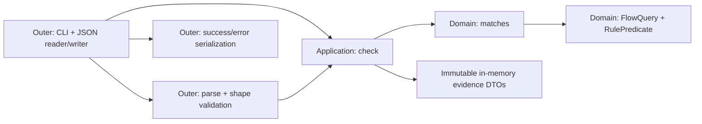

# D3 — Checker L1 domain, architecture and detailed design (CANDIDATE)

**Status:** `D3_AUTHOR_DRAFT / D4_NOT_RUN / IMPLEMENTATION_NOT_AUTHORIZED`. Documentation only; no executable Checker, model run, hidden oracle or new product approval is claimed.  
**Source freeze:** proposed L1 OpenSpec [spec.md](specs/checker-query/spec.md) **Git blob `f67756fbf24f92a194fd802b78a18e6f2151e3e4`** at Draft [PR #51 head `59e2dd1968d20b76030e9deb8a0acd42b894627e`](https://github.com/lehater/agentic-checker-lab/pull/51). If its blob changes, this trace and D4 packet require re-baselining.  
**Parent authorities:** [original owner brief](../../../docs/scenario/owner-problem-brief.md) blob `0061b6f982c015785b59cad4b1b8c9fb95478617`; [owner scope record](../../../docs/evaluation/checker-l1-owner-review.md) blob `aa76e72e231460b05df617cc3dd60417430fe2c3`; [proposed wire contract](../../../docs/evaluation/checker-v1-contract-proposal.md) blob `b5a5cb88ae62ff94072f9fec6f22afb8df273a0e`; [input schema](../../../docs/evaluation/checker-v1-input.schema.json) blob `eb6974386bb7e046382cf74bc0e97e8d263b71d7`; [Engineering Policy](../../../docs/engineering/policy.md) main blob `3eac8b241f843ae25ca6239e82960e4e353ba1c0`; [architecture contract](../../../docs/engineering/architecture-contract.json).  
**Process:** [D0–D6 plan](https://github.com/lehater/agentic-checker-lab/blob/aa9ad497a9620e12172f867d37b720d61adc420b/docs/project/design-stage-plan.md), [D2 minimum stack](https://github.com/lehater/agentic-checker-lab/blob/aa9ad497a9620e12172f867d37b720d61adc420b/docs/project/design-stack.md). [D4 reviewer handoff](../../../docs/design/checker-l1-d4-review-packet.md) binds this document's exact blob. The catalog CHK-001..016 is public, `NOT_RUN`, not a held-out acceptance oracle.

**Split-tree warning:** this design branch inherits the pre-D2 Draft PR #51 tree and does **not** contain the D0/D2 files linked above. Those process sources intentionally point to immutable merged `main` commit `aa9ad497a9620e12172f867d37b720d61adc420b`. Do not resolve them relative to this branch; reconcile both trees before eventual merge to `main`.

## 1. Source authority and scope

| Tag | Meaning | Design use |
| --- | --- | --- |
| **O** | Owner meaning in original brief and D-001..D-012 in [historical Q/D ledger](https://github.com/lehater/agentic-checker-lab/blob/experiment/iterative-discovery-protocol/docs/discovery/checker/ledger.json) (blob `6e25f5249416579d27462e2f54b26925339ee251`); PR #51 records explicit owner approval of the **synthetic L1 scope and observable semantics**. The original chat evidence is not independently linkable from GitHub. | Preserve meanings and declared L1 deferrals; do not silently rewrite them. |
| **P** | Engineering Policy AR-01..05 accepted on `main`. | Design constraint, not a product scenario. |
| **C** | Engineering candidate in unmerged PR #51: IPv4/JSON/CLI/wire grammar, duplicate/strict validation and fail-atomic behavior; this D3 module design is also **C**. | Review independently before claiming accepted/frozen spec/design. |
| **F** | Deferred beyond synthetic L1. | Record boundary only; do not design speculative infrastructure. |

**Purpose (O):** find **all saved ACL rule occurrences** matching the specified five-dimensional *directed* flow on provided relevant firewalls/ACLs, grouped `FW → named ACL + distinct relevant placements → matched rows`. Preserve stored row order, action and per-ACL last-success evidence; no implicit deny or end-to-end reachability verdict.

**L1 executable boundary (approved scope as recorded; C wire):** one local UTF-8 JSON input with one flow, preselected relevant FW/ACL placement facts and one complete saved snapshot for each relevant named ACL. No topology/routing computation, real device polling, collector/retry/logging, snapshot history, storage, vendor parser, HTTP, UI or deployment work. A zero-ACL relevant firewall and zero relevant firewalls are valid. D-002/D-003 (real relevance), D-006 (durable last-success replacement) and D-008 (failed-refresh preservation/log) remain **F**, *not satisfied by synthetic placeholders*.

## 2. Domain language, identity and invariants

| Concept | Identity / contents | Owner of behavior |
| --- | --- | --- |
| **FlowQuery** | `src_ip`, `dst_ip` exact IPv4; `protocol∈{tcp,udp}`; `src_port,dst_port∈PortFilter={Any,Exact(0..65535)}`. Omitted query port → `Any`. Direction is fixed. | Domain's value semantics; parsed by input adapter (O for wildcard/direction; C for IPv4 syntax). |
| **RulePredicate** | `src_ip,dst_ip∈IPv4ExactOrNetwork`; `protocol∈{tcp,udp,any}`; each saved port predicate `Any|Exact|InclusiveRange(min,max)`. | Pure Domain matcher (O five fields; C supported grammar). |
| **RuleOccurrence** | A saved row in an ACL snapshot, identity **`(device_id,acl_id,snapshot_index)`**, where index is zero-based original array position; action `permit|deny`. Equal text at different indices is **not** duplicate. | Domain evaluates predicate; Application preserves row occurrence/action and evidence (O). |
| **RelevantFirewall** | Unique `id`, first-seen order, possibly **no** ACLs. | Input evidence supplied externally; Application preserves grouping (O). |
| **RelevantACL** | Identity `(firewall.id,acl.id)`; duplicates within FW combine into **one** ACL group. ACL with same name on another FW is different. May have zero matches. | Application grouping (O), duplicate policy (C). |
| **Placement** | `Interface(name,direction=ingress|egress)` or `Global`; repeated identical placement retained only once, first-seen order. | Application collection, not route inference (O/C). |
| **ACLSnapshot** | One complete synthetic saved snapshot per relevant ACL, with `last_success_at` UTC timestamp and `rules[]` in saved order. Snapshot is separate from placement; key `(device_id,acl_id)`. | Application evidence integrity/provenance (O per ACL; C exactly-one input contract). |
| **SupplementalRuleData** | `extra` arbitrary JSON-compatible object representing *display-only* conditions, e.g., time range/established. It is never passed to `matches`. | Boundary adapter retains opaque data; Application carries it to report; Domain does not interpret it (O). |
| **CheckReport** | Ordered FW/ACL/placement/matched-occurrence hierarchy, timestamps, and no global verdict. | Application constructs transport-neutral report; output adapter serializes (O/C). |

**Invariants:**

- **I-01 (O):** match is a conjunction of five supported dimensions; **query** port `Any` skips *that query filter*, not a demand that the stored rule cover every port. Query TCP/UDP must match stored same protocol or stored `any`. No automatic reverse flow.
- **I-02 (O):** `matches` does not inspect action, first-match ordering or supplemental `extra`; retain every matching occurrence, including permit+deny and equal-text duplicates, at ascending original snapshot indices.
- **I-03 (O):** relevance/placement is **supplied fact** for L1. Preserve every relevant FW even when ACL list empty; preserve a named ACL even when zero rows match. Empty matched list does **not** establish ACL emptiness, implicit deny or connection outcome.
- **I-04 (O/C):** group ACL by `(FW id, ACL id)` and retain distinct placements; a duplicated placement never duplicates matching row output. FW IDs are unique; repeated FW object is input error (C).
- **I-05 (O/C):** ACL timestamps belong to their own saved snapshots, not device-level lookup date. Missing/invalid initial snapshot is **not** a valid zero-match observation (C error contract).
- **I-06 (C):** every relevant named ACL has **exactly one** well-formed snapshot; no orphan or duplicate snapshot; unused snapshots do not establish hidden relevance. Full input is validated before any successful report.
- **I-07 (C):** invalid/unsupported mandatory predicate grammar fails explicitly; `extra` alone never fails matching; unknown mandatory keys cannot be silently classified as supplemental.
- **I-08 (P):** no domain/application dependency on CLI, JSON, filesystem or live network. Mutating supplied evidence is prohibited by L1 scope.

**No complex aggregates required:** a complete ACL snapshot is the useful consistency unit. FW/ACL are grouping identities, not persistent aggregate roots. There are no domain events, services, polymorphic rule hierarchies or snapshot repositories in this slice (KISS/YAGNI).

## 3. Minimal architecture and responsibility ownership



**Physical layout (C, future implementation only):**

| Proposed module / layer | Responsibility and contract | Must not own |
| --- | --- | --- |
| `src/acl_checker/domain/model.py` | Typed immutable flow/predicate values, `Any/Exact/Range`, row occurrence identity and basic invariants | JSON shape, file paths, CLI, loading snapshots |
| `src/acl_checker/domain/matching.py` | `matches(flow, predicate) -> bool`: pure five-dimension matching | FW/ACL grouping, I/O, action verdict, supplemental conditions |
| `src/acl_checker/application/check.py` | `check(request: CheckRequest) -> CheckReport | CheckError`: validate cross-object evidence, deduplicate ACL references/placements, walk snapshots in order, call domain matcher, assemble hierarchical report | JSON parser, filesystem/network I/O, transport status codes |
| `src/acl_checker/application/contracts.py` | Small immutable application-facing DTOs and explicit error variants; no generic persistence abstractions | Domain predicates' algorithms, JSON serialization |
| `src/acl_checker/input/*.py` | Decode local UTF-8 JSON; check version, lexical/types/schema, normalized flow and saved-rule predicates; produce typed request while retaining exact output evidence | Business matching or global verdict |
| `src/acl_checker/cli/*.py` | One-shot entrypoint, file read, call use case, success JSON or stderr/nonzero; single composition point | Routing inference, ACL rules |
| `tools/validate_checker_l1_input.py` in PR #51 | Existing **public** format/lint evidence; align parsing/validation with it rather than silently introducing a second grammar | Hidden oracle, executable matching, independently verified acceptance |

**Dependency direction:** `domain → only stdlib/domain`; `application → domain + application contracts`; `input/cli → application/domain`. Within inner packages no import of `cli`, `input`, `infrastructure` or `presentation`. No circular imports. Existing project [architecture-contract.json](../../../docs/engineering/architecture-contract.json) explicitly maps `matches` to **domain**, `check` to **application**, and forbids `domain/application/check.py` as responsibility placement; do **not** relax the contract to make a generated skeleton pass.

**No injected repository/service port in L1:** complete supplied local evidence is already `CheckRequest` input. A direct pure use-case function plus value DTOs is the smallest test seam. If later runtime relevance or snapshot loaders require replacement, introduce a narrowly scoped input provider/port then, without teaching domain about external formats. This is the selected alternative to speculative `IRepository`, DI container and topology-service abstractions.

## 4. Detailed contracts (language-neutral pseudotypes; C until D4)

```text
PortFilter       = Any | ExactPort(value: UInt16)
StoredPort       = Any | ExactPort(value: UInt16) | PortRange(min: UInt16, max: UInt16)
StoredIPv4       = IPv4Host | IPv4Network(canonical CIDR)
StoredProtocol   = tcp | udp | any
RulePredicate    = {src_ip, dst_ip: StoredIPv4; protocol: StoredProtocol;
                    src_port, dst_port: StoredPort}
FlowQuery        = {src_ip, dst_ip: IPv4Host; protocol: tcp|udp;
                    src_port, dst_port: PortFilter}
Placement        = Global | Interface(name: NonEmptyString, direction: ingress|egress)
RuleOccurrence   = {snapshot_index: NonNegativeInt; action: permit|deny;
                    predicate: RulePredicate; extra: OpaqueSupplementalData?}
RelevantACL      = {id: NonEmptyString; placements: Placement[]}
RelevantFirewall = {id: NonEmptyString; acls: RelevantACL[]}
ACLSnapshot      = {device_id, acl_id: NonEmptyString; last_success_at: UtcInstant;
                    rules: RuleOccurrence[]}
CheckRequest     = {flow: FlowQuery; firewalls: RelevantFirewall[];
                    snapshots: ACLSnapshot[]}
MatchedRow       = {snapshot_index: NonNegativeInt; rule: OriginalValidatedRule}
ACLReport        = {id: String; placements: Placement[]; last_success_at: UtcInstant;
                    matched_rules: MatchedRow[]}
FWReport         = {id: String; acls: ACLReport[]}
CheckReport      = {firewalls: FWReport[]}
matches(flow: FlowQuery, predicate: RulePredicate) -> bool
check(request: CheckRequest) -> Result<CheckReport, CheckError>
```

`OriginalValidatedRule` denotes the complete allowed saved action/matcher/`extra` fields; the **domain matcher sees only `RulePredicate`**. Application can carry the validated opaque original value as evidence without parsing the supplemental semantics. Output adapter owns `schema_version:1`, `snapshot_index` and JSON field spellings. No special `NO_MATCH` status is needed: `matched_rules: []` is the truthful observable result when the snapshot exists and is valid.

**Match table (O for behavior, C for grammar):**

| Dimension | True iff | Invalid/unknown |
| --- | --- | --- |
| Query exact src/dst IP vs saved exact/CIDR | Saved host equals flow host or canonical network contains flow host, respectively | Parsing rejects malformed/noncanonical IPv4/CIDR |
| Protocol | Saved `any` or same `tcp/udp` | Unsupported mandatory protocol rejects request |
| Source/destination port | Query filter `Any`: **true** regardless of saved port restriction; query `Exact(n)`: saved `any`, equal exact, or inclusive `min≤n≤max` | Out-of-range, bool-as-int, reversed range and unsupported shape reject request |
| Action and `extra` | Excluded from match predicate | Valid supplemental `extra` is carried unchanged, not interpreted |

**Cross-object contract (C):** reject duplicate firewall IDs; collapse repeated ACL references *within* a FW by ACL ID, collecting first-seen distinct placements; reject duplicate snapshot keys, missing snapshot for referenced ACL or orphan snapshot without referenced ACL. Preserve first-seen FW/ACL/placement order (C) and rule-array order (O). Empty FW list must have no snapshots; a relevant FW with zero ACL needs no snapshot. Two FWs with equal ACL names must not share a snapshot.

**CLI boundary (C from PR #51):** `checker check --input PATH` reads one local UTF-8 versioned JSON document, returns exactly one schema-versioned success JSON object on stdout with exit `0`. Any input/evidence/unsupported mandatory matcher error produces **nonzero exit**, **nonempty stderr diagnostic**, **no success/partial stdout**. No specific numeric nonzero code or diagnostic wording is frozen. File/UTF-8/JSON errors belong to outer layer; no application or domain errors are printed directly. Read/parse + validate all relevant references and mandatory rule syntax *before* output serialization (no streaming partial reports).

**Error algebra (C):**

| Variant / stage | Reason | Boundary effect |
| --- | --- | --- |
| `InputDecodeError` / outer | Unreadable path, invalid UTF-8/JSON | Nonzero + stderr; empty success stdout |
| `InputContractError` / input | Missing/unknown keys, wrong types/version, invalid IPv4/CIDR/UTC/range/IDs/action/port | Same |
| `EvidenceIntegrityError` / application | Duplicate FW or snapshot key; orphan/missing snapshot; inconsistent cross-object identity | Same |
| `UnsupportedMandatoryMatcher` / input/domain construction | Mandatory predicate not represented by approved v1 matcher grammar | Same |
| Valid zero-match / application | All evidence complete, no supported row matches | **Success** with FW/ACL present and `matched_rules:[]` |

Input parser validates **all** supplied mandatory rule predicates, not just rows likely to match one flow, so a malformed irrelevant-looking row cannot silently produce success. This is an intentional candidate strictness aligned with fail-atomic/closed evidence handling; D4 must assess proportionality.

## 5. One-shot use-case sequence

1. **Outer decode:** read the explicit path and UTF-8 JSON; reject invalid version/unknown mandatory shape, normalize omitted ports to `Any`, materialize domain values and immutable evidence DTOs. Original saved rule attributes and `extra` remain available to report.
2. **Application preflight:** validate unique FW IDs; coalesce ACL duplicates per FW while collecting distinct placements; index snapshot keys; validate exactly-one relevant snapshot, no missing/orphan snapshot, complete provenance, and all supported mandatory rules. **Abort before producing a success report** if any failure is found.
3. **Application execute:** iterate relevant FWs in given order, grouped ACLs in first-seen order, each snapshot's saved rows by `enumerate` original zero-based position; call `domain.matches` for each predicate and include every true row with its original index, action and supplemental evidence. No short-circuit on first permit or deny.
4. **Application project:** retain FW with zero ACL, and named ACL with zero matches; include distinct placements and **that ACL's** `last_success_at`. Do not generate implicit deny or verdict.
5. **Outer serialize:** only after successful complete report, emit one JSON object. For errors, emit nonempty diagnostic on stderr with nonzero exit and no success stdout.

**Consistency & complexity:** an in-memory map from `(FW id, ACL id)` to snapshot validates evidence in approximately `O(F + A + R)` time and `O(A + R)` bounded temporary/report space for F firewall records, A ACL references/snapshots and R rows. No caching, asynchronous work or IO inside matching. Actual asymptotics depend on placement dedup sets; no performance promise is implied.

## 6. Engineering decision record (D3-ADR-01, candidate)

**Decision:** one local command; typed immutable in-memory request; pure rule matcher and one application `check` orchestrator; strict preflight; no provider/service/repository interfaces until a second genuine data source exists.

- **Alternative A — one CLI function for everything:** fewer modules but violates AR-01/03 if parsing, matching and orchestration are mixed; difficult independent tests and wrong symbol ownership.
- **Alternative B — DDD aggregate + repositories + ports/factories + route/collector services:** extension-ready on paper but adds hypothetical variation and state not required by synthetic L1 (YAGNI).
- **Selected:** small module boundaries with ordinary functions and DTOs, domain value objects and explicit errors. Present dependency contract is enforceable by project policy, without gratuitous layers.
- **Consequences:** later live collection/relevance needs a separate design and ports, not hidden within L1; no persistent snapshot history; error policy is strict and reviewable rather than implied.
- **Open review tension:** a synthetic saved rule with `protocol: any` and numeric port predicates is allowed by draft grammar; rule applicability beyond the five-field search remains intentionally unproven. Reviewer should ensure no output phrasing implies a full firewall decision.

## 7. Requirement and acceptance-idea trace

**Trace convention:** `O` owner meaning / approved synthetic boundary as recorded, `C` unmerged engineering contract / design candidate, `F` explicitly deferred. CHK-001..016 are **public proposed scenarios, all NOT_RUN**. These are trace references, not an independent acceptance oracle.

| Decision / status | Design property / owning element | Public acceptance ideas |
| --- | --- | --- |
| D-001 **O**, L1 wire **C** | FlowQuery, local one-shot boundary, no reachability verdict (§1–5) | CHK-001,002,010 |
| D-002 **O/F** | FW relevance is **preselected**; no route-based interface inference implemented (§1,3) | CHK-005,015 exercise handoff only; real computation deferred |
| D-003 **O/F** | Selected ingress/egress/global placements are provided, preserved; no applicability algorithm (§2–5) | CHK-005,008; real selection deferred |
| D-004 **O**, grammar **C** | Five-dimension `matches`; `extra` display-only and unknown mandatory syntax rejected (§2,4) | CHK-004,009,013 |
| D-005 **O** | Occurrence index, all matches/actions in snapshot order, no first-match (§2,5) | CHK-003,008,014 |
| D-006 **O/F**, timestamp handoff **O** | Snapshot keyed by FW/ACL and own `last_success_at`; durable last-success lifecycle deferred (§2–5) | CHK-016 covers supplied timestamps only |
| D-007 **O** | Retain FW with empty ACL list and named ACL with empty matches, no implicit deny (§2,5) | CHK-007,015 |
| D-008 **O/F** | No collector, failed-refresh logging or stale-data replacement in L1 (§1,5) | No executable CHK coverage; future collector suite |
| D-009 **O**, JSON field grammar **C** | Required directed IPs/TCP-UDP and wildcard/omitted ports; invalid inputs fail (§2,4) | CHK-001,002,011 |
| D-010 **O**, duplicate ID policy **C** | Group ACL by `(FW,ACL)`, de-dupe placements not row occurrences (§2,4) | CHK-005,008,014 |
| D-011 **O** | Directed single-query semantics; no reverse query (§2,4) | CHK-012 |
| D-012 **O** | FW→ACL+placements→rows, retain zero-child parents (§2,5) | CHK-007,008,015 |
| L1 missing-snapshot/error **C** | Explicit evidence-integrity failure; never substitute empty success; no partial stdout (§4–5) | CHK-006,009 |
| AR-01..03 **P** | Domain/application/outer responsibilities and inward dependencies (§3) | Independent architecture review; structural validator when code exists |
| AR-04..05 **P** | No silent pass, separate structural/semantic/oracle gates (§4,8) | Public CHK ideas not counted as test results |

**Coverage gaps, deliberately retained:** no scenario verifies future D-002 route inference, D-003 ACL selection, D-006 snapshot replacement or D-008 failed collection; none is silently considered completed. The D3 design does not write `tasks.md` or authorize implementation.

## 8. Review risks, gates and next action

| Severity | Risk or unresolved decision | Owner / required action |
| --- | --- | --- |
| **P0 blocker** | PR #51 spec/JSON/duplicate/error contract remains an unmerged candidate; current owner approval is **recorded** but not an independently verified final semantic review; public CHK catalog cannot substitute for held-out oracle. | Independently reconcile spec revision and owner semantics; no D5/D6 claims. |
| **P1** | Ambiguity between mandatory five-field predicate and `extra` on future vendor data; strict rejection of unknown keys/extra snapshots may be too severe for a future ingestion mode. | D4 assess against *synthetic* contract; no vendor extension now. |
| **P1** | Wrong grouping or deduplicating identical row text can lose evidence; blindly selecting latest FW-level timestamp falsely changes provenance. | D4 review ownership, cardinalities, sample counterexamples and CHK trace. |
| **P1** | Query `any` interpreted as stored wildcard / actual-port universal coverage produces false negative/positive claims. | D4 specifically challenge `Any` port filter and action-free matching. |
| **P2** | Text/JSON echo of `extra` may be mistaken for applied time/established logic. | D4 demand neutral observation vocabulary; do not evaluate `extra`. |
| **P2** | Current architecture-contract only enforces declared paths/symbols and cannot prove these semantics. | D4 semantic review separately; retain existing validator. |

**Exit from authoring D3:** exact frozen spec blob, complete candidate `design.md`, trace and **independent D4 packet with exact design blob**. Status remains `D4_NOT_RUN` even if GitHub CI passes. A separate independent evaluator must review frozen inputs and issue findings P0–P3 with adjudicated disposition and verdict. Changed content invalidates a previous review. Only after accepted L1 spec + D4 review + **independently frozen private oracle and local operator preflight (D5)** could a bounded implementation experiment be separately authorized; none occurs in D3.
